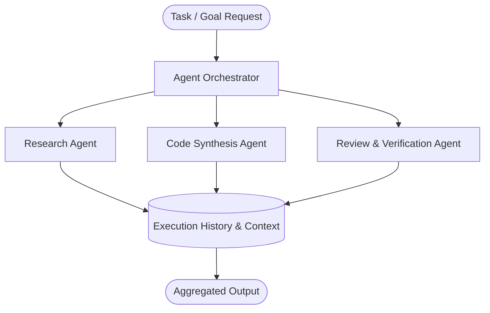

# 🤖 Agentic Workflows Python

[](https://www.python.org/)
[](https://opensource.org/licenses/MIT)
[](#architecture)

An extensible, lightweight Python framework for designing, executing, and orchestrating autonomous multi-agent workflows. Built with clean separation of concerns, history tracking, and dynamic task delegation.

---

## 🚀 Key Features

- **Autonomous Agent Workflows**: Encapsulate task logic, goal definitions, and execution pipelines.
- **Centralized Orchestration**: `AgentOrchestrator` coordinates multiple agents, schedules interdependent tasks, and resolves graph dependencies.
- **Execution History & Telemetry**: Comprehensive step logging with JSON-exportable audit trails.
- **Extensible Architecture**: Easily integrate with OpenAI, Anthropic, Gemini, or local LLMs (Ollama / vLLM).
- **Type-Safe**: Full type hinting across agents, workflows, and state containers.

---

## 🏗️ Architecture



---

## 📦 Installation

```bash
# Clone the repository
git clone https://github.com/Tamanash-009/agentic-workflows-python.git
cd agentic-workflows-python

# Create a virtual environment
python -m venv venv
source venv/bin/activate  # On Windows: venv\Scripts\activate

# Install dependencies
pip install -r requirements.txt
```

---

## 💻 Quick Start

```python
from agent_orchestrator import AgentOrchestrator

# Initialize the orchestrator
orchestrator = AgentOrchestrator(orchestrator_name="ProductionPipeline")

# Instantiate specialized agent workflows
analyzer = orchestrator.create_agent(agent_name="DataAnalyzer", agent_id="agent-01")
synthesizer = orchestrator.create_agent(agent_name="ReportSynthesizer", agent_id="agent-02")

# Run agentic workflow
result = orchestrator.run_pipeline(input_data={"query": "Analyze Q4 fleet logistics"})
print(result)
```

---

## 📂 Project Structure

```
agentic-workflows-python/
├── agent_orchestrator.py   # Multi-agent coordination and pipeline execution engine
├── main.py                 # Core AgentWorkflow base definitions and entry point
├── requirements.txt        # Runtime dependencies
└── README.md               # Technical documentation
```

---

## 👨‍💻 Author

**Tamanash Chakraborty**
- GitHub: [@Tamanash-009](https://github.com/Tamanash-009)
- LinkedIn: [Tamanash Chakraborty](https://linkedin.com/in/tamanashchakraborty)

## 📄 License
This project is licensed under the MIT License - see the LICENSE file for details.
